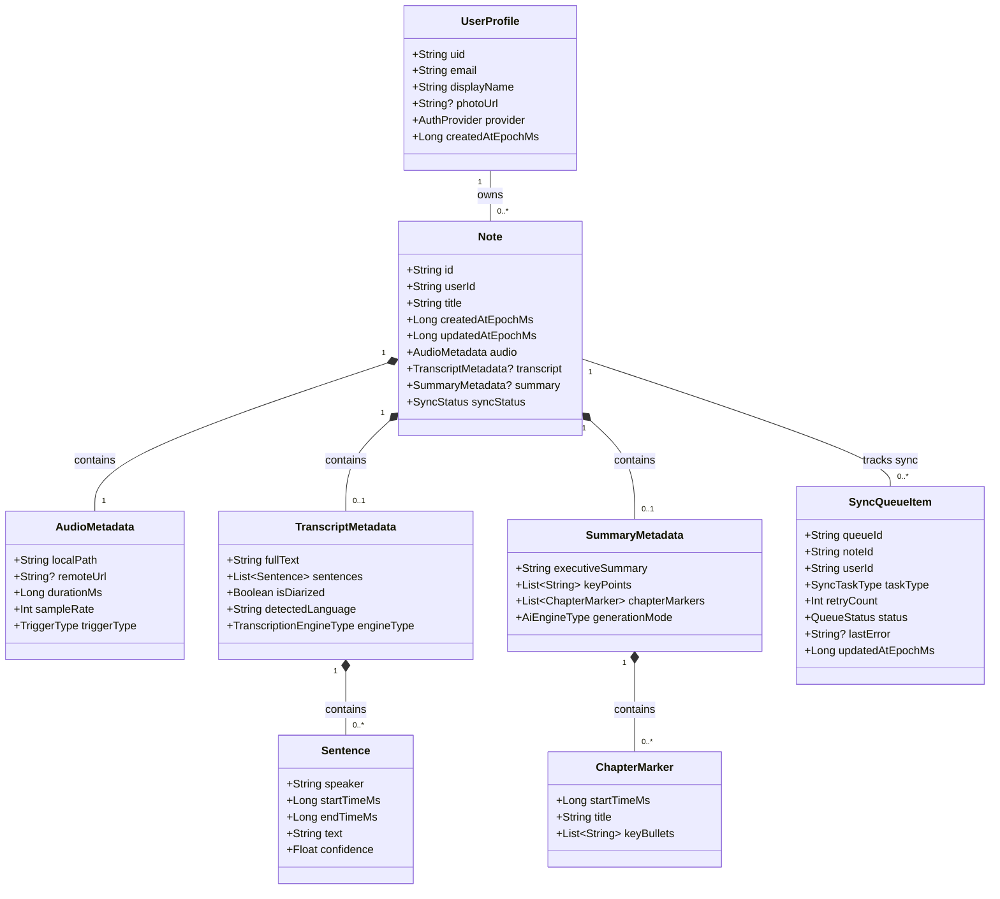

# Data Model: Unit 2 — Firebase, Auth & Storage (Unified Domain Model)

This document establishes the canonical domain entities, relationships, validation constraints, and storage schemas for Knockledge, unifying the data contracts between Unit 4 (Audio/Knock), Unit 3 (Transcription), Unit 1 (AI Engine), and Unit 2 (Persistence & Identity).

---

## 1. Unified Domain Entities



---

### Entity Specifications

#### 1.1 `UserProfile`
Represents the authenticated student identity authenticated via Firebase Auth.

| Field | Type | Description | Validation |
|-------|------|-------------|------------|
| `uid` | `String` | Firebase User ID | Non-empty unique string |
| `email` | `String` | User email address | Valid email format RFC 5322 |
| `displayName` | `String` | User profile name | Non-blank string (1 to 50 chars) |
| `photoUrl` | `String?` | Optional avatar image URL | Valid HTTPS URI or null |
| `provider` | `AuthProvider` | Primary auth method | `GOOGLE` or `EMAIL_PASSWORD` |
| `createdAtEpochMs` | `Long` | Timestamp of account creation | $> 0$ |

#### 1.2 `Note` (Aggregate Root)
The master lecture note record unifying captured audio, transcript diarization, and AI summarization.

| Field | Type | Description | Validation |
|-------|------|-------------|------------|
| `id` | `String` | Note UUID identifier | Standard UUID v4 format |
| `userId` | `String` | Owner user identifier | Matches active `UserProfile.uid` |
| `title` | `String` | Note title | Non-blank (defaults to timestamp if pre-AI) |
| `createdAtEpochMs` | `Long` | Note capture timestamp | Epoch milliseconds $\le$ current time |
| `updatedAtEpochMs` | `Long` | Last update timestamp | $\ge \text{createdAtEpochMs}$ |
| `audio` | `AudioMetadata` | Audio capture metadata | Must be present upon creation |
| `transcript` | `TranscriptMetadata?` | Diarized transcript | Null while speech processing runs |
| `summary` | `SummaryMetadata?` | AI structured summary | Null while AI processing runs |
| `syncStatus` | `SyncStatus` | Cloud sync state | `LOCAL_ONLY`, `SYNCING`, `SYNCED`, `SYNC_FAILED` |

#### 1.3 `AudioMetadata` (Ingested from Unit 4 `AudioSnapshot`)

| Field | Type | Description | Validation |
|-------|------|-------------|------------|
| `localPath` | `String` | Absolute path in app storage | Points to existing `.wav` file on device |
| `remoteUrl` | `String?` | Firebase Storage download URL | Null until audio upload completes |
| `durationMs` | `Long` | Audio duration in milliseconds | $1000 \le \text{durationMs} \le 300000$ (max 5 min) |
| `sampleRate` | `Int` | Sampling rate in Hertz | Must equal $16000$ |
| `triggerType` | `TriggerType` | Source of recording trigger | `GESTURE` (double knock) or `MANUAL` |

#### 1.4 `TranscriptMetadata` (Ingested from Unit 3 `TranscriptResult`)

| Field | Type | Description | Validation |
|-------|------|-------------|------------|
| `fullText` | `String` | Complete speech transcription | Non-blank string |
| `sentences` | `List<Sentence>` | Timestamped diarized utterances | Non-empty list |
| `isDiarized` | `Boolean` | Speaker turns identified | `true` (online) or `false` (offline fallback) |
| `detectedLanguage` | `String` | Detected language code | e.g., `"en"`, `"fil"`, `"taglish"` |
| `engineType` | `TranscriptionEngineType` | Speech engine utilized | `CLOUD_FIREBASE_AI` or `LOCAL_WHISPER` |

#### 1.5 `SummaryMetadata` (Ingested from Unit 1 `NoteMetadata`)

| Field | Type | Description | Validation |
|-------|------|-------------|------------|
| `executiveSummary` | `String` | High-level lecture summary | Non-blank text |
| `keyPoints` | `List<String>` | High priority takeaways | List of non-empty strings |
| `chapterMarkers` | `List<ChapterMarker>` | Timestamped chapter markers | List sorted ascending by `startTimeMs` |
| `generationMode` | `AiEngineType` | AI engine utilized | `CLOUD_FIREBASE_AI` or `LOCAL_ON_DEVICE` |

#### 1.6 `SyncQueueItem`

| Field | Type | Description | Validation |
|-------|------|-------------|------------|
| `queueId` | `String` | Unique queue item identifier | UUID v4 |
| `noteId` | `String` | Associated note identifier | Valid note ID |
| `userId` | `String` | Owner user identifier | Valid user UID |
| `taskType` | `SyncTaskType` | Task action type | `UPLOAD_AUDIO` or `SYNC_FIRESTORE` |
| `retryCount` | `Int` | Number of failed attempts | $\ge 0$ |
| `status` | `QueueStatus` | Task progress state | `QUEUED`, `PROCESSING`, `FAILED` |
| `lastError` | `String?` | Last failure message | Optional error text |
| `updatedAtEpochMs` | `Long` | Last state transition time | Positive epoch millis |

---

## 2. Enumerations

```kotlin
enum class AuthProvider {
    GOOGLE,
    EMAIL_PASSWORD,
}

enum class SyncStatus {
    LOCAL_ONLY,
    SYNCING,
    SYNCED,
    SYNC_FAILED,
}

enum class TriggerType {
    GESTURE,
    MANUAL,
}

enum class TranscriptionEngineType {
    CLOUD_FIREBASE_AI,
    LOCAL_WHISPER,
}

enum class AiEngineType {
    CLOUD_FIREBASE_AI,
    LOCAL_ON_DEVICE,
}

enum class SyncTaskType {
    UPLOAD_AUDIO,
    SYNC_FIRESTORE,
}

enum class QueueStatus {
    QUEUED,
    PROCESSING,
    FAILED,
}
```

---

## 3. Storage Schemas

### 3.1 Local Room SQLite Tables

#### `notes` Table
```sql
CREATE TABLE IF NOT EXISTS notes (
    id TEXT PRIMARY KEY NOT NULL,
    user_id TEXT NOT NULL,
    title TEXT NOT NULL,
    created_at_epoch_ms INTEGER NOT NULL,
    updated_at_epoch_ms INTEGER NOT NULL,
    audio_local_path TEXT NOT NULL,
    audio_remote_url TEXT,
    audio_duration_ms INTEGER NOT NULL,
    audio_sample_rate INTEGER NOT NULL,
    audio_trigger_type TEXT NOT NULL,
    transcript_full_text TEXT,
    transcript_sentences_json TEXT,
    transcript_is_diarized INTEGER,
    transcript_detected_language TEXT,
    transcript_engine_type TEXT,
    summary_executive_summary TEXT,
    summary_key_points_json TEXT,
    summary_chapter_markers_json TEXT,
    summary_generation_mode TEXT,
    sync_status TEXT NOT NULL
);

CREATE INDEX IF NOT EXISTS index_notes_user_id ON notes (user_id);
CREATE INDEX IF NOT EXISTS index_notes_created_at ON notes (created_at_epoch_ms DESC);
```

#### `sync_queue` Table
```sql
CREATE TABLE IF NOT EXISTS sync_queue (
    queue_id TEXT PRIMARY KEY NOT NULL,
    note_id TEXT NOT NULL,
    user_id TEXT NOT NULL,
    task_type TEXT NOT NULL,
    retry_count INTEGER NOT NULL DEFAULT 0,
    status TEXT NOT NULL,
    last_error TEXT,
    updated_at_epoch_ms INTEGER NOT NULL,
    FOREIGN KEY (note_id) REFERENCES notes (id) ON DELETE CASCADE
);

CREATE INDEX IF NOT EXISTS index_sync_queue_user_status ON sync_queue (user_id, status);
```

### 3.2 Cloud Firestore Document Schema

Path: `/users/{userId}/notes/{noteId}`

```json
{
  "id": "uuid-string",
  "userId": "firebase-uid",
  "title": "Lecture on Distributed Systems",
  "createdAtEpochMs": 1729000000000,
  "updatedAtEpochMs": 1729000050000,
  "audio": {
    "remoteUrl": "https://firebasestorage.googleapis.com/...",
    "durationMs": 30000,
    "sampleRate": 16000,
    "triggerType": "GESTURE"
  },
  "transcript": {
    "fullText": "Speaker 1: Good morning class...",
    "sentences": [
      {
        "speaker": "Speaker 1",
        "startTimeMs": 0,
        "endTimeMs": 3200,
        "text": "Good morning class.",
        "confidence": 0.98
      }
    ],
    "isDiarized": true,
    "detectedLanguage": "en",
    "engineType": "CLOUD_FIREBASE_AI"
  },
  "summary": {
    "executiveSummary": "Introduction to consensus algorithms.",
    "keyPoints": [
      "Overview of Paxos and Raft",
      "Failure handling in network partitions"
    ],
    "chapterMarkers": [
      {
        "startTimeMs": 0,
        "title": "Introduction",
        "keyBullets": ["Welcome", "Course outline"]
      }
    ],
    "generationMode": "CLOUD_FIREBASE_AI"
  }
}
```

---

## 4. End-to-End Cross-Unit Data Lifecycle

```text
[Unit 4: Knock Sensor & Audio Buffer]
       │
       ▼ (AudioSnapshot: file, 16kHz WAV, durationMs, triggerType)
[Unit 2: NoteRepository.createFromSnapshot(snapshot, userId)]
       │
       ├─► Saves WAV permanently to context.filesDir/audio/{noteId}.wav
       ├─► Inserts NoteEntity into Room (syncStatus = LOCAL_ONLY)
       └─► Enqueues UPLOAD_AUDIO in sync_queue
       │
       ▼ (Passes Audio to Speech Pipeline)
[Unit 3: Transcriber.transcribe(pcm, sampleRate)]
       │
       ▼ (TranscriptResult: fullText, sentences with speaker tags)
[Unit 2: NoteRepository.attachTranscript(noteId, transcript)]
       │
       ├─► Updates NoteEntity in Room with transcript JSON
       └─► Enqueues SYNC_FIRESTORE in sync_queue
       │
       ▼ (Passes Transcript to AI Pipeline)
[Unit 1: AiEngine.summarize(transcript)]
       │
       ▼ (AiSummaryResult: title, executiveSummary, chapterMarkers)
[Unit 2: NoteRepository.attachSummary(noteId, summary)]
       │
       ├─► Updates NoteEntity in Room with title and summary
       └─► Enqueues SYNC_FIRESTORE in sync_queue
       │
       ▼ (Background Sync on Network Connection)
[Unit 2: SyncEngine]
       ├─► Uploads WAV to Firebase Storage: /users/{userId}/audio/{noteId}.wav
       ├─► Sets audio.remoteUrl on NoteEntity
       ├─► Writes complete document to Firestore: /users/{userId}/notes/{noteId}
       └─► Sets NoteEntity syncStatus = SYNCED
```
