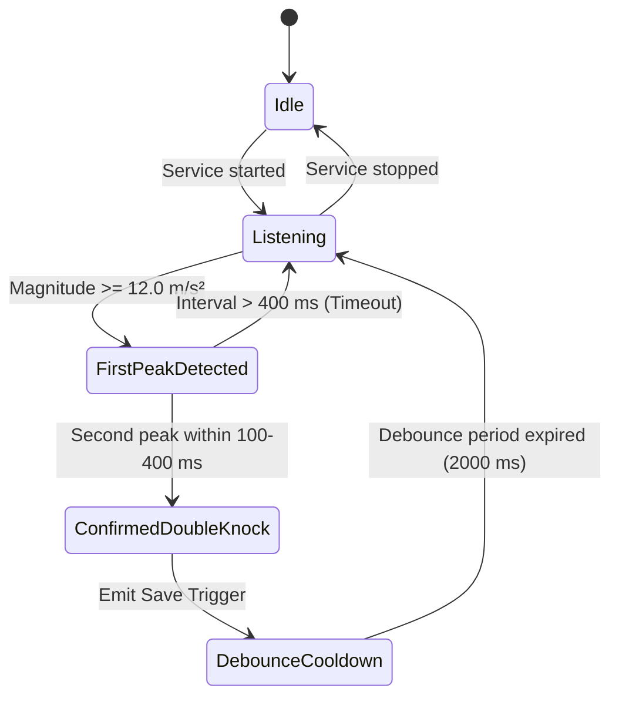
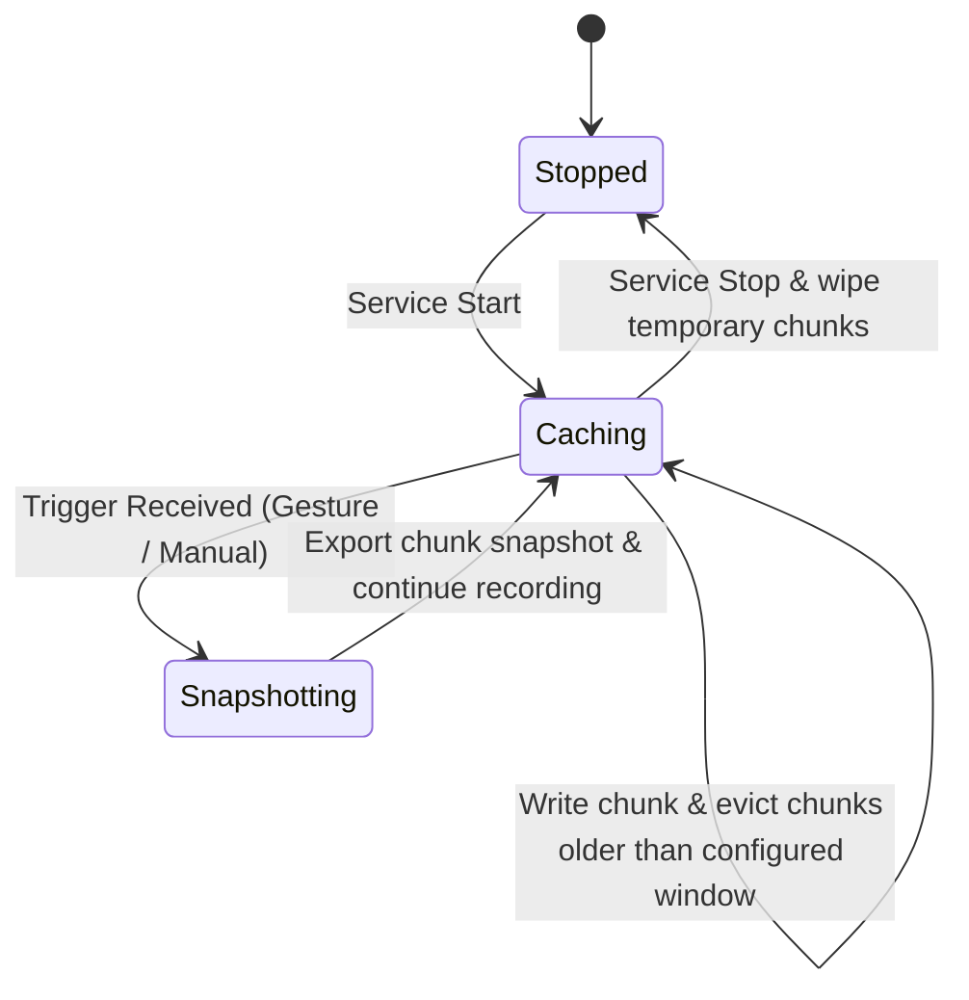

# Data Model: Unit 4 — Knock Gesture & Recording

This document defines the core domain entities, validation rules, and state machines for the knock gesture recording pipeline.

## Entities

### 1. BufferConfiguration
Defines the operating parameters for the rolling audio buffer in local storage.

| Field | Type | Description | Validation |
|-------|------|-------------|------------|
| `durationSeconds` | `Int` | Configured window length | $60 \le \text{durationSeconds} \le 300$ |
| `sampleRate` | `Int` | Audio sample rate in Hertz | Must equal $16000$ |
| `chunkDurationMs` | `Int` | Duration of each storage chunk | Set to $5000\text{ ms}$ |
| `storageDirectory` | `File` | App-specific cache folder | Directory must exist and be writable |

### 2. KnockSensorSample
A single reading from the hardware motion sensor.

| Field | Type | Description | Validation |
|-------|------|-------------|------------|
| `x` | `Float` | Linear acceleration on X axis | Valid float value |
| `y` | `Float` | Linear acceleration on Y axis | Valid float value |
| `z` | `Float` | Linear acceleration on Z axis | Valid float value |
| `magnitude` | `Float` | Calculated vector magnitude | $\sqrt{x^2 + y^2 + z^2}$ |
| `timestampNs` | `Long` | System sensor event timestamp | Monotonically increasing |

### 3. KnockGestureEvent
Represents a validated double-knock trigger.

| Field | Type | Description | Validation |
|-------|------|-------------|------------|
| `firstPeakTimeMs` | `Long` | Timestamp of first detected peak | Positive epoch millis |
| `secondPeakTimeMs` | `Long` | Timestamp of second detected peak | $100\text{ ms} \le (\text{second} - \text{first}) \le 400\text{ ms}$ |
| `peakMagnitude` | `Float` | Maximum recorded acceleration | $\ge 12.0\text{ m/s}^2$ |
| `triggerSource` | `TriggerType` | Source of trigger | `GESTURE` or `MANUAL` |

### 4. AudioSnapshot
The finalized audio recording written to disk for downstream processing.

| Field | Type | Description | Validation |
|-------|------|-------------|------------|
| `file` | `File` | Exported audio file on disk | Valid file with non-zero size |
| `startEpochMs` | `Long` | Clip start time in epoch millis | $\le \text{endEpochMs}$ |
| `endEpochMs` | `Long` | Clip end time in epoch millis | Captured trigger time |
| `durationMs` | `Long` | Total audio duration | $\text{endEpochMs} - \text{startEpochMs}$ |
| `sampleRate` | `Int` | Sample rate in Hertz | Must equal $16000$ |
| `triggerType` | `TriggerType` | How the snapshot was created | `GESTURE` or `MANUAL` |

---

## State Machines

### Knock Detection State Machine

### Audio Cache Buffer Lifecycle

